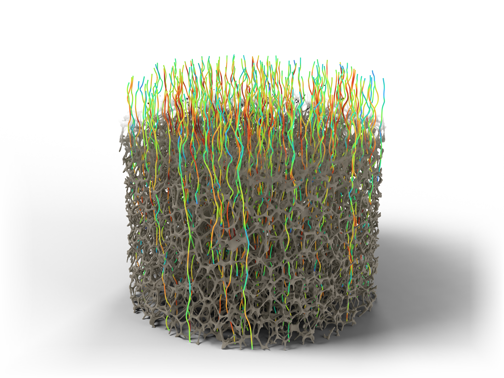
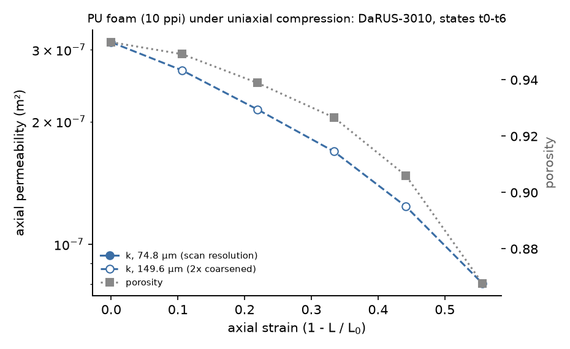

# Open-cell polyurethane foam: permeability from a micro-CT scan, under compression

Example of PoreWise as an image-based characterisation tool: the axial permeability of a real
foam core, computed from its micro-CT scan at seven stages of a uniaxial compression test. Open-cell
foams are used as filters, separators, acoustic and fluid-management media; their permeability and
how it changes when the foam is compressed in service or during processing are design inputs.



*The whole sample (52 mm across, 44 mm long), flow upwards, on the 149.6 µm grid. Streamlines are coloured by local
speed, blue (slow) to red (fast). The struts are faded out near the top for display only. A close-up at scan resolution
is in [`pu_foam_detail.png`](../figures/materials/pu_foam_detail.png).*

## Data

M. Ruf and H. Steeb (2024), *In situ micro-XRCT data set of an open-cell polyurethane foam sample
under uniaxial compression load*, DaRUS, https://doi.org/10.18419/DARUS-3010, **CC BY 4.0**.

- **Sample:** reticulated PU foam, 10 pores per inch, a cylinder 52 mm in diameter and 50 mm long.
- **States:** scanned at t0–t6 under imposed displacements of 0, 5, 10, 15, 20 and 25 mm, then 0 mm again (t6). The
  sample relaxed for 20 min before each scan.
- **Images:** segmented stacks (skeleton 255, void 0) with a documented voxel size of 74.8 µm, extracted by the authors
  with a cylinder of 52.36 mm diameter.
- **Voxel-size check:** the fitted cylinder is 699 voxels across, which is 52.29 mm at 74.8 µm. t0 is 593 slices,
  44.36 mm, against the documented usable length of 44.26 mm. Both support 74.8 µm.

`examples/materials/pu_foam/prepare.py fetch` downloads the segmented stacks with checksum verification.

| State | displacement (mm) | nominal strain (/50 mm) | axial strain vs t0 | length (mm) | porosity | apparent solid volume / t0 | k, 74.8 µm (m²) | k, 149.6 µm (m²) |
|---|---|---|---|---|---|---|---|---|
| t0 | 0 | 0.00 | 0.000 | 44.36 | 0.9534 | 1.000 | 2.89 × 10<sup>-7</sup> | 3.13 × 10<sup>-7</sup> |
| t1 | 5 | 0.10 | 0.106 | 39.64 | 0.9491 | 0.975 | not run | 2.67 × 10<sup>-7</sup> |
| t2 | 10 | 0.20 | 0.219 | 34.63 | 0.9389 | 1.023 | not run | 2.14 × 10<sup>-7</sup> |
| t3 | 15 | 0.30 | 0.334 | 29.55 | 0.9266 | 1.048 | not run | 1.69 × 10<sup>-7</sup> |
| t4 | 20 | 0.40 | 0.442 | 24.76 | 0.9060 | 1.126 | not run | 1.24 × 10<sup>-7</sup> |
| t5 | 25 | 0.50 | 0.556 | 19.67 | 0.8677 | 1.259 | not run | 8.01 × 10<sup>-8</sup> |
| t6 | 0 | 0.00 | 0.000 | 44.36 | 0.9539 | 0.988 | not run | 3.15 × 10<sup>-7</sup> |

Porosity is measured inside the sample cylinder.

**Apparent solid volume.** It stays within 3 % of t0 up to 10 mm of displacement and then rises by 26 % at 25 mm.
Polyurethane is effectively incompressible, so this rise is not physical. It reflects the segmentation of densified,
touching struts (partial volume) at high strain. Every state is cut by the same 52.36 mm cylinder, so any lateral
bulging is not in the data. The porosity of the most compressed states, and the permeabilities computed from them,
carry this uncertainty.

## Physics and method

**Assumptions:** saturated, steady, creeping Newtonian flow through the pore space, with no slip on the struts (Stokes
equations).

**Domain:**
- **Sealed core:** the sample cylinder is kept and everything outside it is solid, like a core in a sleeve. So the flow
  is along the axis only, and nothing passes outside the sample.
- **Ends:** the two end faces of a scanned sample do not match, so a periodic domain joins mismatched struts. The
  standard configuration adds free-fluid reservoirs (1.5 mm) inside the sleeve at both ends. Their resistance is removed
  afterwards as a series term: L/k<sub>app</sub> = L<sub>s</sub>/k<sub>s</sub> + L<sub>b</sub>/k<sub>b</sub>, with
  k<sub>b</sub> = R²/8 for the open sleeve.
- **Alternative ends:** mirrored and periodic ends are run for comparison.

**Normalisation.** PoreWise reports k with the mean velocity over the whole grid. Here the sample is a cylinder inside a
square grid, so the Darcy flux of the sample is the same volume flow divided by the sample area:
k<sub>sample</sub> = k<sub>grid</sub> / (A<sub>sample</sub>/A<sub>grid</sub>). The cylinder fills 67.8 % of the grid, so
without this correction k would be 32 % low. That was the error found in the first version of this example.

**Resolution:**
- **Scan resolution:** one run, the uncompressed state t0, on a central 200-slice section (15.0 mm; 88.7 million
  fluid nodes) so that it fits one 48 GB GPU.
- **Coarse grid:** the 149.6 µm runs use the whole length of all seven states. Two coarsening rules are compared:
  - "quarter": a cell is solid if at least 25 % of its block is skeleton. This keeps thin struts connected but thickens
    them.
  - "porosity-preserving": the threshold reproduces the scan's solid fraction exactly.

**Solver settings:** TRT, τ = 1.5, single precision, convergence tolerance 10<sup>-6</sup>.

## Verification and sensitivity (t0)

| Configuration | porosity | k (m²) | iterations | plane-flux CV | mass drift |
|---|---|---|---|---|---|
| coarse 149.6 µm, quarter rule, periodic ends, τ = 1.0 | 0.9335 | 2.393 × 10<sup>-7</sup> | 5000 | 8.4e-06 | 4.5e-13 |
| coarse, quarter rule, periodic ends, τ = 1.5 | 0.9335 | 2.393 × 10<sup>-7</sup> | 11000 | 8.4e-06 | 7.8e-12 |
| coarse, porosity-preserving, periodic ends | 0.9534 | 3.106 × 10<sup>-7</sup> | 8500 | 7.7e-06 | 4.6e-12 |
| coarse, porosity-preserving, mirrored | 0.9534 | 3.180 × 10<sup>-7</sup> | 7500 | 1.2e-05 | 1.1e-12 |
| coarse, porosity-preserving, fluid buffers | 0.9534 | 3.131 × 10<sup>-7</sup> | 6500 | 1.4e-05 | 2.9e-12 |
| coarse, porosity-preserving, buffers, central 26.9 mm | 0.9545 | 3.220 × 10<sup>-7</sup> | 6000 | 1.7e-05 | 1.9e-12 |
| scan resolution 74.8 µm, buffers, central 15.0 mm | 0.9550 | 2.893 × 10<sup>-7</sup> | 14000 | 3.3e-05 | 3.4e-12 |

Full report: [materials_verification.md](materials_verification.md).

## Results

**Compression.** On the 149.6 µm grid the axial permeability falls from 3.13 × 10<sup>-7</sup> m² (t0) to 8.01 × 10<sup>-8</sup> m² at 25 mm displacement (t5): a ratio of 0.26.
The unloaded state t6 returns to 3.15 × 10<sup>-7</sup> m², close to t0, consistent with its porosity (0.9539 against 0.9534).

**Resolution.** At scan resolution, t0 gives 2.89 × 10<sup>-7</sup> m² on its central 15.0 mm section, 8 % below the
coarse-grid value for the whole length. The two runs differ in both voxel size and section, so this is an indication of
the resolution effect, not a clean measure of it.



## Comparison with published data

- **Absolute value** at t0: within the range reported for 10 ppi open-cell foams of high porosity, about
  10<sup>-7</sup> m².
  - Reticulated PU, 10 ppi: 4.6 × 10<sup>-8</sup> m² at porosity 0.976 (Efstathiou & Luhar 2018); 1.6 × 10<sup>-7</sup> m²
    (Manes et al. 2011, as cited there).
  - Metal 10 PPI foams: 1.0–1.8 × 10<sup>-7</sup> m² (Bhattacharya et al. 2002; Mancin et al. 2010; Dukhan 2006, as
    tabulated by Kumar 2014).
  - These are Forchheimer fits or different foams, so only the order of magnitude is compared.
- **The dataset authors' own permeability study** (Krach, Ruf & Steeb 2025, InterPore Journal 2(1)) reports, read off
  their Fig. 10, about 2 × 10<sup>-11</sup> m² at zero strain. That is four orders of magnitude below both this result
  and the literature range above, which points to a unit or scaling difference that could not be resolved from the
  paper. Their ratio over the same compression range is about 0.22.
- **Compression trend:**
  - Regressions for compressed open-cell foams give k/k₀ ≈ (1 − ε)<sup>1.8</sup> (Gent & Rusch) to
    (1 − ε)<sup>2.2</sup> (Hilyard & Collier), as quoted by Dawson (2008).
  - Dawson measured k/k₀ = 0.18–0.22 at ε = 0.6 for fine PU foams.
  - The ratio computed here over 0 to 0.5 nominal strain is the value above, to be read against these.

## Engineering conclusions

- Permeability can be extracted from the scan of a real foam with the sample's true cross-section: at the scan's own
  resolution for the uncompressed state, and on a 2× coarser grid for the compression series.
- Compressing the foam along the flow direction lowers its permeability progressively, and the change is reversible
  here (t6).
- The scan-resolution result and the coarse-grid result differ by the amount in the sensitivity table. Struts only a
  few voxels thick make the result resolution-dependent, so the voxel size has to be stated with any number.

## Limitations

- **Single sample:** one foam, one flow direction (the loading axis), one scan per state. No repeat samples.
- **Segmentation:** the authors' segmentation is used as given. Its effect grows at high strain (the apparent rise in
  solid volume above).
- **Scan-resolution run:** t0 only, on a central 15.0 mm section. The compression series is on the 149.6 µm grid, whole
  length.
- **Boundary conditions:** the sealed core with fluid buffers is an idealisation of a permeameter. The sleeve walls are
  no-slip at the cut cylinder surface, and lateral bulging is not represented.
- **Flow regime:** Stokes flow only. Forchheimer effects at practical flow rates through 10 ppi foams are not covered.

## Reproduce

```bash
python examples/materials/pu_foam/prepare.py fetch && python examples/materials/pu_foam/prepare.py survey
for s in t0 t1 t2 t3 t4 t5 t6; do python examples/materials/pu_foam/run.py --state $s --resolution coarse; done   # compression series
python examples/materials/pu_foam/run.py --state t0 --resolution full --crop 200 --save-fields                   # scan resolution
python examples/materials/pu_foam/run.py --state t0 --resolution coarse --ends mirror                            # end-condition variants
python examples/materials/summarise.py && python examples/materials/pu_foam/figures.py
```

## References and attribution

- Ruf M., Steeb H. (2024). In situ micro-XRCT data set of an open-cell polyurethane foam sample under uniaxial compression load. DaRUS. https://doi.org/10.18419/DARUS-3010. CC BY 4.0. The images are used unmodified; only coarsened copies are derived for the sensitivity runs.
- Krach D., Ruf M., Steeb H. (2025). InterPore Journal 2(1), doi:10.69631/ipj.v2i1nr39.
- Efstathiou C., Luhar M. (2018). J. Fluid Mech. 841, 351–379.
- Bhattacharya A., Calmidi V.V., Mahajan R.L. (2002). Thermophysical properties of high porosity metal foams. Int. J. Heat Mass Transfer 45, 1017–1031.
- Dawson M.A. (2008). Modeling the dynamic response of low-density, reticulated, elastomeric foam impregnated with Newtonian and non-Newtonian fluids. PhD thesis, MIT. (Journal version: Dawson, Germaine, Gibson 2007, Int. J. Solids Struct. 44, 5133.)
