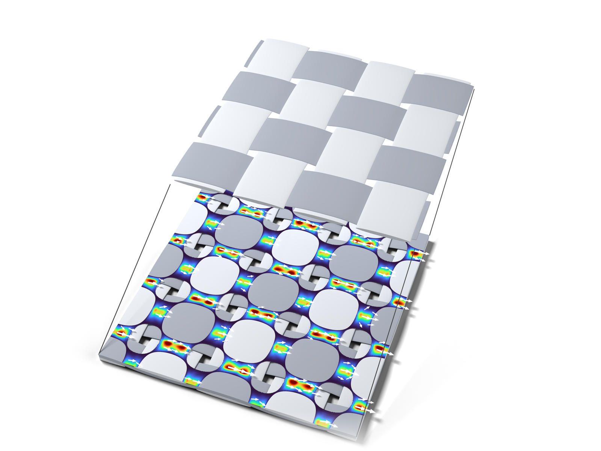

# Woven composite preform: resin flow between the tows

Example of PoreWise as a mesoscale tool for liquid composite moulding (RTM, resin infusion). The
in-plane permeability of a dry woven preform is the main material input of a mould-filling
simulation (Darcy's law, **q** = −(**K**/μ)∇p): it sets fill times, injection pressures and where
dry spots form. This example computes the in-plane permeability tensor of an idealised carbon
plain-weave preform at two compaction states, shows where the resin flows, and checks the
numbers against resolution, solver parameters and published textile data.



*Relaxed state, 5 µm grid. Colour: local speed on the plane between the two plies, blue (slow) to red (fast); arrows:
in-plane flow direction. The upper ply is lifted and set back for display only; the flow was computed with the plies
nested.*

## The textile

A 3K carbon plain weave of the commercial 200 g/m² class: 5.0 ends/cm and 5.0 picks/cm (yarn
spacing 2.0 mm), 3K tows of 7 µm filaments (fibre density 1.78 g/cm³). Datasheets of such fabrics
give 200 g/m² ± 4 % and a dry thickness of about 0.32 mm (Compositesplaza CAWFINPL200; R&G
CT-200100P). The geometry here gives an areal weight within that tolerance (table below).

The model is built the way TexGen builds woven textiles (elliptical tow sections swept along crimped
paths, interference removal, layer nesting), in `examples/materials/woven_preform/geometry.py`:

- **Tow path:** z = ±(h/2)·g(cos(πu/s)), with g(c) = tanh(βc)/tanh(β) and β = 1.5. β flattens the path over the
  crossings, where real tows lie on each other. A plain sinusoid (β = 0) with elliptical sections of width w intersects
  the crossing tow unless w < 2s/π. For the tow widths used here it would interpenetrate by 3–6 % of the tow volume.
- **Section:** elliptical, width w and thickness h. h follows from the tow's fibre area and the assumed intra-tow fibre
  fraction (πwh/4 = fibre area / intra-tow V<sub>f</sub>).
- **Interference:** with β = 1.5 the overlap before correction is at most the value in the table. Any remaining shared
  point goes to the tow in which it lies deeper (TexGen's principle); the solid is unchanged.
- **Plain-weave pattern:** warp and weft centrelines are on opposite sides at every crossing (checked for all four
  crossings of the unit cell).
- **Two plies:** the second ply is shifted half a yarn spacing in x and y and lowered onto the first until they touch
  (nesting by contact).
- **Mould:** in the closed-mould case, rigid plates sit on the outermost crests. The cavity is a whole number of cubic
  voxels, centred on the preform, so no tow-free slot is left. The earlier version of this example had a 140 µm slot
  under the mould that carried 52 % of the flow.
- **Infinite laminate (implemented, not reported):** `--stack periodic` repeats the same two plies periodically through
  the thickness, with no mould. No results for it are reported here.

Two compaction states of the same fabric: compaction flattens and widens the tows (higher intra-tow fibre fraction,
smaller gaps) and the plies nest closer.

| State | s (mm) | w (mm) | h (µm) | gap (µm) | intra-tow V<sub>f</sub> (assumed) | ply thickness (µm) | tow volume fraction | fibre V<sub>f</sub> | areal weight (g/m²) | overlap before correction | tow-free layers |
|---|---|---|---|---|---|---|---|---|---|---|---|
| relaxed | 2.00 | 1.70 | 139 | 300 | 0.62 | 257 | 0.723 | 0.452 | 206 | 0.00 % | 0 |
| compacted | 2.00 | 1.85 | 110 | 150 | 0.72 | 205 | 0.782 | 0.566 | 206 | 0.09 % | 0 |

The intra-tow fibre fraction is an assumption. Values of 0.56–0.71 are measured or used in the literature (Syerko et al.
2023: 0.56 by CT of a glass tow; Wong et al. 2006: 0.60; Nedanov & Advani 2002: 0.71). The fibre volume fraction of the
preform is the intra-tow fraction times the tow volume fraction. These ply thicknesses match the cured-ply estimate
t = 200/(1780·V<sub>f</sub>) for this areal weight.

## Physics and method

**Assumptions:**
- Saturated, steady, creeping flow of a Newtonian resin between the tows: Stokes equations, no slip on the tows and the
  mould.
- The tows are impermeable, so only inter-tow flow is resolved.
  - For 7 µm fibres at an intra-tow fraction of 0.6–0.7, Gebart's formulas give tow permeabilities of 2 × 10<sup>-14</sup>
    to 3 × 10<sup>-13</sup> m², three to four orders below the results here.
  - Published comparisons of dual-scale and impermeable-tow models of woven fabrics put the effect on saturated in-plane
    permeability at about 3–30 % (Alotaibi et al. 2021).
  - Unsaturated, dual-scale filling (void formation, delayed tow impregnation) is outside this model.

**Solver:** PoreWise D3Q19 lattice Boltzmann.
- Collision: TRT, magic parameter 3/16, so walls sit half-way between nodes and the permeability is independent of the
  relaxation time. τ = 1.5.
- Driving force: a uniform body force along x (warp) or y (weft); periodic in x and y.
- Precision and convergence: double precision, convergence tolerance 10<sup>-6</sup>.
- Permeability: k = ν⟨u⟩/F, with ⟨u⟩ the mean velocity over the cavity (mould plates excluded), i.e. the Darcy velocity
  of the preform.
- The off-diagonal terms come from the velocity component normal to the load.
- **Through-thickness permeability is not computed.** With impermeable tows, flow across the plies can only pass where
  inter-tow openings of neighbouring plies happen to line up. That makes k<sub>zz</sub> a property of the nesting
  assumption rather than of the fabric, and in real preforms it is dominated by intra-tow flow, which is not modelled.

## Results

| State | Stacking | voxel (µm) | fibre V<sub>f</sub> | tow vol. fraction | k<sub>xx</sub> (m²) | iterations | plane-flux CV | Mach | Re<sub>pore</sub> |
|---|---|---|---|---|---|---|---|---|---|
| compacted | 2 plies, mould | 10 | 0.566 | 0.782 | 1.957 × 10<sup>-11</sup> | 81000 | 8.3e-06 | 3.7e-05 | 1.2e-04 |
| compacted | 2 plies, mould | 20 | 0.566 | 0.803 | 1.717 × 10<sup>-11</sup> | 35500 | 4.3e-06 | 8.6e-06 | 1.5e-05 |
| compacted | 2 plies, mould | 5 | 0.566 | 0.782 | 1.925 × 10<sup>-11</sup> | 144000 | 1.7e-05 | 1.5e-04 | 9.6e-04 |
| relaxed | 2 plies, mould | 10 | 0.452 | 0.731 | 4.682 × 10<sup>-11</sup> | 76000 | 1.0e-05 | 7.2e-05 | 4.8e-04 |
| relaxed | 2 plies, mould | 20 | 0.452 | 0.717 | 5.726 × 10<sup>-11</sup> | 50500 | 4.6e-06 | 1.9e-05 | 7.0e-05 |
| relaxed | 2 plies, mould | 5 | 0.452 | 0.723 | 5.036 × 10<sup>-11</sup> | 73000 | 1.9e-05 | 3.1e-04 | 4.0e-03 |

At 5 µm the moulded two-ply preform gives k = 5.04 × 10<sup>-11</sup> m² (relaxed) and 1.92 × 10<sup>-11</sup> m² (compacted). Compaction lowers
the permeability by a factor of 2.6.

### Where the resin flows

| State (5 µm, mould) | volume of the two cavity layers at the mould | flow in those layers | open straight channels along x (area) | flow in those channels |
|---|---|---|---|---|
| relaxed | 1.9 % | 1.2 % | 8.0 % | 52.1 % |
| compacted | 2.4 % | 2.6 % | 7.9 % | 66.6 % |

The open straight channels are the gaps between neighbouring warp tows, running over and under the weft where it
crosses at mid-ply height. They are part of the plain-weave architecture, not an artefact: in a real fabric these
inter-tow channels are where the resin front runs ahead. The figure
[`woven_section_compacted.png`](../figures/materials/woven_section_compacted.png) shows the axial velocity in sections
across the flow.

## Verification and sensitivity

Full report: [materials_verification.md](materials_verification.md).

**Resolution:** k<sub>xx</sub> at 20, 10 and 5 µm and the change at each halving of the voxel size:

| State | Stacking | k, 20 µm (m²) | k, 10 µm (m²) | k, 5 µm (m²) | change 20 → 10 µm | change 10 → 5 µm |
|---|---|---|---|---|---|---|
| relaxed | 2 plies, mould | 5.726 × 10<sup>-11</sup> | 4.682 × 10<sup>-11</sup> | 5.036 × 10<sup>-11</sup> | -18.2 % | 7.6 % |
| compacted | 2 plies, mould | 1.717 × 10<sup>-11</sup> | 1.957 × 10<sup>-11</sup> | 1.925 × 10<sup>-11</sup> | 14.0 % | -1.7 % |

The sequences are not monotone (the 20 µm grid puts only 7 to 15 voxels across the gaps), so no order of convergence or extrapolated value is quoted. The change from 10 to 5 µm is taken as the resolution uncertainty of the 5 µm values.

**Relaxation time** (compacted, 10 µm, TRT):

| τ | k<sub>xx</sub> (m²) |
|---|---|
| 1 | 1.9571 × 10<sup>-11</sup> |
| 1.5 | 1.9571 × 10<sup>-11</sup> |
| 2.5 | 1.9571 × 10<sup>-11</sup> |

**In-plane tensor** (loads along x and y):

| State | Stacking | voxel (µm) | τ | k<sub>xx</sub> | k<sub>yy</sub> | \|k<sub>xy</sub>\|/k<sub>xx</sub> |
|---|---|---|---|---|---|---|
| compacted | mould | 10 | 1.5 | 1.957 × 10<sup>-11</sup> | 1.957 × 10<sup>-11</sup> | 1.5e-04 |
| compacted | mould | 20 | 1.5 | 1.717 × 10<sup>-11</sup> | 1.717 × 10<sup>-11</sup> | 1.4e-04 |
| compacted | mould | 20 | 1 | 1.717 × 10<sup>-11</sup> | 1.717 × 10<sup>-11</sup> | 1.4e-04 |
| relaxed | mould | 10 | 1.5 | 4.682 × 10<sup>-11</sup> | 4.682 × 10<sup>-11</sup> | 2.1e-03 |
| relaxed | mould | 20 | 1.5 | 5.726 × 10<sup>-11</sup> | 5.726 × 10<sup>-11</sup> | 1.6e-03 |

The fabric is balanced and the ply shift is symmetric, so k<sub>xx</sub> = k<sub>yy</sub> is expected; it holds to the
digits shown, and the off-diagonal terms are negligible.

## Comparison with published data

No experiment matches this fabric, these compaction states and this stacking, so no experimental validation is claimed.

- **Measured, comparable fabrics:**
  - Carbon 2×2 twill (6K, 285 g/m²) at V<sub>f</sub> = 45.3 %: K₁ = 1.39 × 10<sup>-10</sup> and K₂ = 0.73 × 10<sup>-10</sup> m²
    (Vernet et al. 2014, benchmark II, unsaturated).
  - Glass 2/2 twill at V<sub>f</sub> = 45.6 / 49.5 / 53.3 %: median K₁ = 6.1 / 4.1 / 2.6 × 10<sup>-11</sup> m²
    (May et al. 2019, benchmark III).
  - Glass plain weave: about 7 × 10<sup>-11</sup> at 45 % and 2 × 10<sup>-11</sup> m² at 54 % (Verleye et al. 2008, read off
    a figure).
- **Mesoscale simulations of plain weaves** typically sit above measurements: a 40–50 % gap is reported by Verleye et al.
  2008, and factors of about 2 by Zeng et al. (FPCM12).
- **The values computed here** fall in the same 10<sup>-11</sup>–10<sup>-10</sup> m² range at comparable fibre volume
  fractions, and decrease with compaction as the measurements do.

The remaining differences have identifiable causes: the idealised tow shapes, impermeable tows, the two-ply closed-mould
stacking, and the measured fabrics being twills rather than plain weaves.

## Engineering conclusions

- In a plain weave the resin flows mainly along the gaps between parallel tows and over and under the crossing tows.
  The tows themselves carry almost none of the saturated flow.
- Compaction from the relaxed to the compacted state narrows the gaps (300 → 150 µm) and lowers the in-plane
  permeability by the factor above. The preform architecture, more than the fibre volume fraction alone, sets the flow
  paths.
- With the mould on the tow crests, the cavity layers next to the mould carry about their volume share of the flow
  (table above), so no mould-surface bypass remains.
- For a balanced plain weave with symmetric nesting, the in-plane permeability is isotropic. Unbalanced fabrics or
  shear would make it anisotropic, which the tensor workflow captures.

## Limitations

- **Geometry:** idealised (TexGen-type) shapes, not a scan. Tow width, gap and intra-tow fraction are assumed, and no
  measured 3K tow geometry was found to calibrate them. One unit cell is periodic: no variability, no random nesting,
  no shear.
- **Tows:** impermeable. The saturated value would rise by a few to about 30 % with permeable tows (literature range).
  Unsaturated dual-scale effects are not modelled.
- **Compaction:** represented by two geometric states, not by a mechanical compaction model.
- **Through-thickness permeability:** not computed (see Physics and method).

## Reproduce

```bash
python examples/materials/woven_preform/run.py --dx 0.02 0.01           # both states, x and y loads, closed mould
python examples/materials/woven_preform/run.py --dx 0.005 --directions x   # 5 um (saves the fields for the figures)
python examples/materials/woven_preform/run.py --dx 0.01 --states compacted --tau 1.0 --directions x   # tau check
python examples/materials/summarise.py && python examples/materials/woven_preform/figures.py
```

GPU (`cuda-sparse`); the 5 µm runs take 45 to 80 minutes each on an RTX 6000 Ada. The rendered figure needs Blender 4.5
(`examples/materials/render/cv_final2.py woven_flow`, then `bl_scene.py`).

## References

- Compositesplaza, technical data sheet CAWFINPL200 (carbon plain weave, 200 g/m², 5.0 × 5.0 /cm, 3K).
- Verleye B., Lomov S.V., Long A., Verpoest I., Roose D. (2008). Permeability of textile reinforcements: simulation, influence of shear and validation. Compos. Sci. Technol. 68, 2804–2810.
- Vernet N. et al. (2014). Experimental determination of the permeability of engineering textiles: Benchmark II. Compos. Part A 61, 172–184.
- May D. et al. (2019). In-plane permeability characterization of engineering textiles based on radial flow experiments: a benchmark exercise. Compos. Part A 121, 100–114.
- Gebart B.R. (1992). Permeability of unidirectional reinforcements for RTM. J. Compos. Mater. 26, 1100–1133.
- Alotaibi H., Abeykoon C., Soutis C., Jabbari M. (2021). Numerical simulation of resin flow in a dual-scale textile preform. Materials 14, 405.
- Syerko E. et al. (2023). Compos. Part A 167, 107397 (CT-based intra-yarn fibre volume fraction).
- Wong C.C., Long A.C., Rudd C.D. (2006). FPCM-8 (unit-cell permeability of plain weaves).
- Zeng X., Endruweit A., Long A.C. (FPCM-12). Meso-scale permeability of textiles with nesting and shear.
- Lin H., Brown L.P., Long A.C. (2011). Modelling and simulating textile structures using TexGen. Adv. Mater. Res. 331, 44–47.
